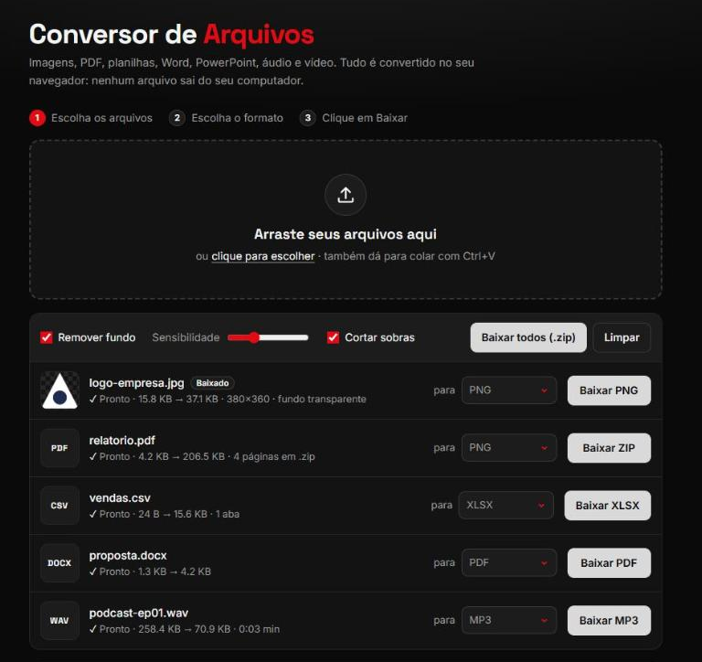

<div align="center">

# Conversor de Arquivos

**Converta imagens, PDF, planilhas, Word, PowerPoint, áudio e vídeo direto no navegador.**
Nenhum arquivo é enviado para servidor: tudo acontece no seu computador.

[](https://sena295.github.io/conversor-imagens/)


-333?logo=nodedotjs&logoColor=white)




</div>

## Recursos

- **Vários formatos em um só lugar**: imagens, PDF, planilhas, documentos, apresentações, áudio e vídeo.
- **Privacidade total**: a conversão roda no navegador, sem upload.
- **Remover fundo**: transforma logos com fundo de cor sólida em PNG ou ICO transparente.
- **Vários arquivos de uma vez**: arraste, clique ou cole com `Ctrl+V`, e baixe tudo em um `.zip`.
- **Juntar imagens em um PDF**: cada imagem vira uma página.
- **Extrair áudio de links** (modo local): YouTube, Instagram, TikTok, X, SoundCloud e [muitos outros](https://github.com/yt-dlp/yt-dlp/blob/master/supportedsites.md).
- **Responsivo**: funciona no computador e no celular.

## Formatos suportados

| De | Para |
|---|---|
| **Imagem**: PNG, JPG, WEBP, GIF, BMP, SVG, AVIF, ICO | JPG, PNG, WEBP, BMP, ICO, PDF |
| **PDF** | PNG ou JPG (uma imagem por página), TXT |
| **Planilha**: XLSX, XLS, ODS, CSV, TSV, JSON | XLSX, CSV, JSON, HTML |
| **Word**: DOCX | PDF, HTML, TXT |
| **Texto**: TXT, MD | PDF, HTML |
| **PowerPoint**: PPTX | TXT (texto dos slides) |
| **Áudio**: MP3, WAV, OGG, M4A, AAC, FLAC, OPUS | MP3, WAV |
| **Vídeo**: MP4, WEBM, MOV | MP3, WAV (extrai o áudio) |
| **Link** (modo local) | MP3, M4A, WAV |

> PPT e DOC antigos (antes de 2007) e HEIC de iPhone não podem ser convertidos no navegador.

## Como usar

### Online

Acesse **https://sena295.github.io/conversor-imagens/**, escolha os arquivos, o formato de cada um e clique em **Baixar**.

### No seu computador (com extração de áudio por link)

Requisitos: [Node.js](https://nodejs.org/), [yt-dlp](https://github.com/yt-dlp/yt-dlp) e [ffmpeg](https://ffmpeg.org/).

```bash
winget install yt-dlp.yt-dlp Gyan.FFmpeg
git clone https://github.com/Sena295/conversor-imagens.git
cd conversor-imagens
node servidor.js
```

Abra **http://localhost:8075**. O servidor aceita conexões apenas do próprio computador.

> Sites com DRM (Spotify, Netflix, Deezer) não são suportados. Baixe apenas conteúdo que você tem direito de usar.

## Estrutura

```
conversor-imagens/
├── index.html    # página
├── style.css     # visual (tema escuro)
├── app.js        # conversões, executadas no navegador
├── servidor.js   # servidor local opcional (site + extração de áudio)
└── docs/         # imagens do README
```

## Tecnologias

As bibliotecas são carregadas sob demanda, só quando um formato precisa delas:

| Biblioteca | Uso |
|---|---|
| [pdf.js](https://mozilla.github.io/pdf.js/) | PDF → imagem e texto |
| [jsPDF](https://github.com/parallax/jsPDF) + [html2canvas](https://html2canvas.hertzen.com/) | geração de PDF |
| [SheetJS](https://sheetjs.com/) | planilhas |
| [Mammoth](https://github.com/mwilliamson/mammoth.js) | documentos Word |
| [lamejs](https://github.com/zhuker/lamejs) | codificação MP3 |
| [JSZip](https://stuk.github.io/jszip/) | arquivos .zip e PowerPoint |
| [yt-dlp](https://github.com/yt-dlp/yt-dlp) + [ffmpeg](https://ffmpeg.org/) | áudio de links (modo local) |

Imagens, BMP, ICO, WAV e a remoção de fundo usam apenas APIs nativas do navegador (Canvas e Web Audio).

## Licença

Distribuído sob a licença [MIT](LICENSE).
